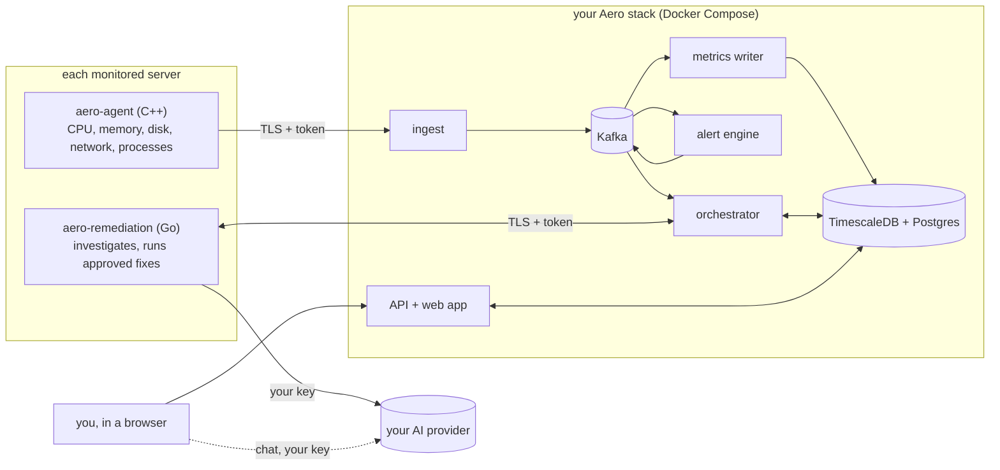

# Aero Agent

Monitors your Linux servers and, when an alert fires, has an AI investigate the cause, explain it in plain
English, and propose a fix. You decide how much it may do on each machine: look, ask first, or act alone
within strict limits. The AI never gets a shell, and every step is recorded.

Built for solo operators, indie developers, homelabs and small teams with no dedicated SRE. The AI runs on
**your own** provider key (Anthropic, OpenAI or a local model), so the platform never stores a key and never pays
for inference.

> **Status: pre-release.** All the pieces exist and work together end to end on one machine, with unit tests
> and a security review of its own design. It has not been run on a real fleet, load-tested, or reviewed by
> outsiders. Read `docs/threat-model.md` before pointing it at servers you care about.

## How it works



1. The agent streams metrics. Rules you write turn them into alerts.
2. An alert opens an incident. The remediation agent on that server gathers context (top processes, logs, disk,
   failed services), asks your AI, and reports a plain-English cause with proposed fixes.
3. Each proposal is checked against an allowlist. Depending on the mode, it runs, or waits for your approval in the dashboard.
4. After a fix it re-checks the metric. If the problem persists, it escalates to you.

**Permission modes, per machine:** *Observe* (explain only), *Recommend* (you approve every fix), *Autonomous*
(safe fixes run alone; dangerous ones still ask). Each machine also sets a local ceiling the dashboard cannot exceed.

## Try it

You need Docker. This starts the whole stack on one machine:

```sh
cd deploy/docker
./gen-certs.sh localhost
cp .env.example .env            # set POSTGRES_PASSWORD
docker compose up -d --build
docker compose run --rm tools userctl invite you@example.com admin --new-org "Your team"   # then sign in with that email
```

Open <https://localhost:8080> (your browser will warn about the self-signed certificate). Then
register a server and install the agents on it: `docs/install-agents.md`. For a real deployment, including
AWS with Terraform, see `deploy/README.md`.

The dashboard is customizable: drag, resize and add widgets, keep several views, export a layout as JSON, and
chat with your own AI about your servers (paste a key; it stays in your browser).

## Layout of the repository

| Path | What |
|---|---|
| `agent/` | C++23 monitoring agent |
| `remediation-agent/` | Go agent: AI investigation, allowlisted actions, approvals, audit chain |
| `backend/` | Go services: ingest gateway, metrics writer, alert engine, orchestrator, API; migrations |
| `web/` | React + TypeScript dashboard |
| `proto/` | gRPC and Protobuf definitions shared by all of the above |
| `deploy/` | Docker Compose stack, Terraform for AWS |
| `docs/` | install guide, threat model |

## Developing

Generated protobuf code is not committed; generate it first. Needs Go (the version in `go.mod`), Node 22,
`protoc`, and for the agent GCC 14 with CMake and gRPC.

```sh
make -C backend proto                       # needs protoc, protoc-gen-go, protoc-gen-go-grpc
(cd backend && go test ./...)
(cd remediation-agent && go test ./...)     # imports the backend's generated code
(cd web && npm ci && npm test && npm run build)
cmake -S agent -B build -DCMAKE_CXX_COMPILER=g++-14 && cmake --build build && ctest --test-dir build
```

CI (`.github/workflows/ci.yml`) runs all of this plus vulnerability, container, Terraform and secret scans on
every change and weekly. The agent builds and runs on Linux only.

## Security

`docs/threat-model.md` describes what is protected and what is not. Report vulnerabilities privately: `SECURITY.md`.

## License

Not chosen yet.
